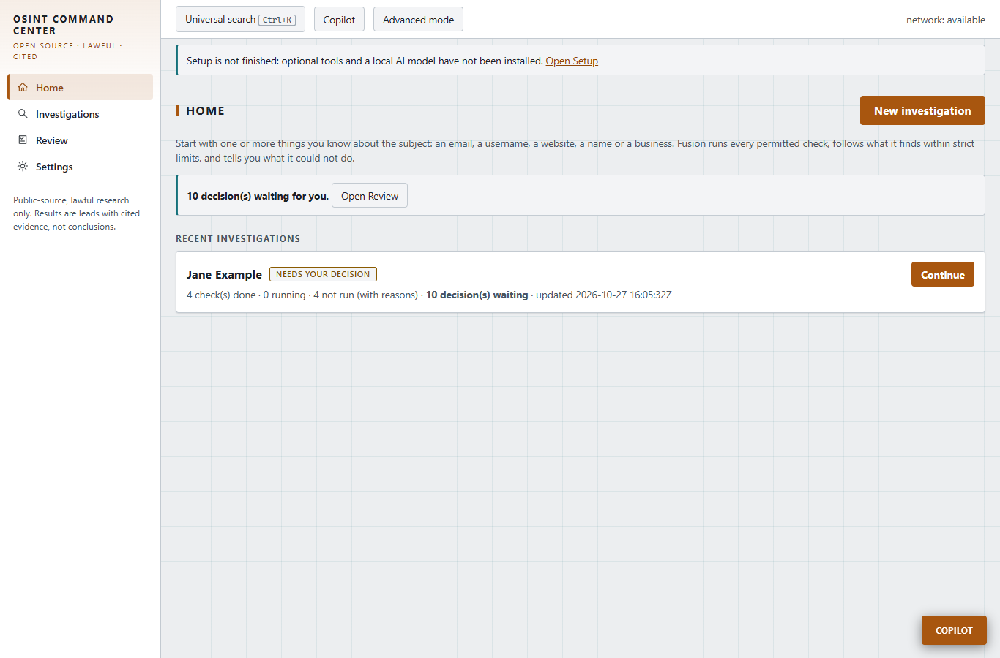
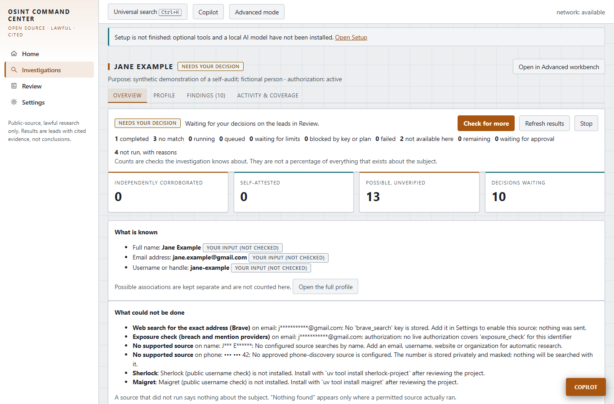
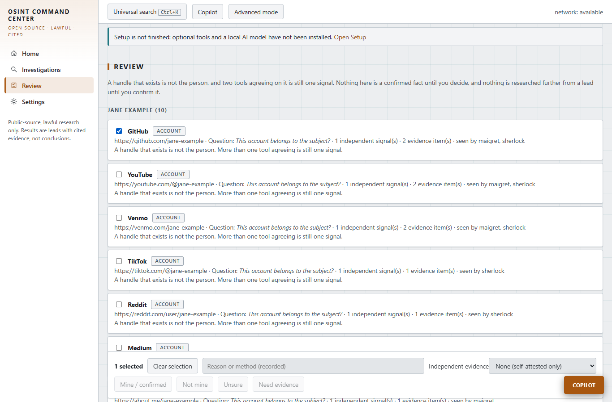
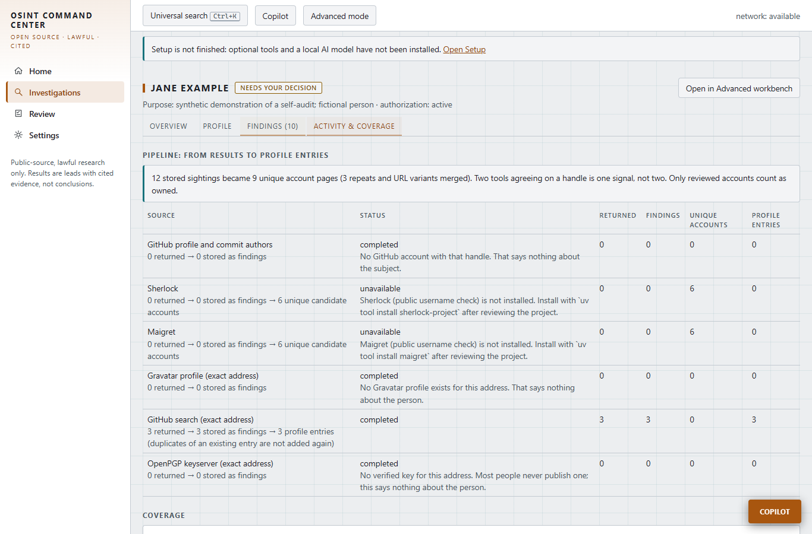

# OSINT Command Center

A local-first workstation for lawful, authorized, evidence-grounded open-source research. You type what you know about a person or a business, press
**Investigate**, and it runs every permitted source it has, follows evidence-backed leads within strict limits, and gives you a readable profile that says
plainly what it found, what it could not check, and why.



> **Use it only on people, businesses and assets you are lawfully permitted to research.** Every investigation records who it is about and why, and the
> app refuses to run without that. It does no interception, credential use, CAPTCHA or rate-limit evasion, facial recognition or scraping behind logins.
> Nothing leaves your machine except requests you confirmed. See [What it will not do](#what-it-will-not-do).

> **Honest status.** The backend, UI, desktop shell and builds have automated tests that pass. Most third-party sources are tested against recorded
> fixtures or mocks, **not against the live services**; the docs mark each source as verified live or not. Releases are unsigned. There is no
> `LICENSE` file yet, so the code is shared for reading and review, not under an open-source licence. Details: [Known limitations](#known-limitations).

---

## Contents

1. [What it does](#what-it-does)
2. [How an investigation works](#how-an-investigation-works)
3. [Install](#install) (build from source, Linux, Windows, Docker build)
4. [First run](#first-run)
5. [Using it](#using-it)
6. [Understanding the results](#understanding-the-results)
7. [Configuration](#configuration)
8. [Where your data lives, backups and upgrades](#where-your-data-lives-backups-and-upgrades)
9. [Development and testing](#development-and-testing)
10. [Project layout](#project-layout)
11. [What it will not do](#what-it-will-not-do)
12. [Known limitations](#known-limitations)
13. [Documentation index](#documentation-index)
14. [Security and responsible use](#security-and-responsible-use)

---

## What it does

- **One-click investigation.** Start from one or more typed identifiers (email, username, website, name, phone, owned domain, organization). The app builds a
  plan, shows exactly which sources would run and which would send an input to a third party, asks one bounded approval, then runs.
- **Bounded automatic follow-up.** Evidence-backed leads (a profile link, an associated email) are followed automatically, but only up to the limits you see:
  by default 2 steps out, 100 source calls, 10 per identifier, 25 follow-ups per pass and 30 minutes. It pauses for your decision on anything uncertain.
- **A master profile you can edit.** 13 categories, each value with a state, its provenance and links to the evidence behind it. Restricted values (such as a
  phone number) are stored masked. Merges are reversible.
- **No overclaiming.** Coverage has distinct states (ran, needs a key, needs approval, unsupported input, not installed, blocked, already done). "Nothing found" is
  only said for a source that actually ran. A run that could not do everything finishes as **complete, with limits** and lists what is missing.
- **Self-attestation is never proof.** If you say "this account is mine", it is recorded as *self-attested*, kept separate from *independently corroborated*.
- **Evidence you can trust later.** Every finding keeps its source, retrieval time and hash. Evidence lives in an AES-256-GCM vault; the database is SQLCipher
  encrypted; reports are encrypted at rest; the audit log is tamper-evident.
- **Reports.** A short brief or an expert export (HTML, Markdown, JSON, PDF), each citing its evidence, with a preview of what is included and withheld.
- **Advanced workbench** (behind an **Advanced** switch). The full multi-discipline analysis suite: strict target parsers, collection plans, importers
  (email, PCAP, EXIF, SBOM, ADS-B/AIS, PDF/DOCX and more), claims with confidence labels, contradictions, hypotheses, a unified timeline, workflows,
  an optional local AI Copilot & Tutor, a read-only MCP server and sandboxed plugins.

| Overview | Review | Coverage |
|---|---|---|
|  |  |  |

The screenshots use synthetic demo data (see `scripts/demo_server.py`), not a real person.

## How an investigation works

```
Type identifiers ──▶ Review plan ──▶ Investigate ──▶ Overview / Profile / Findings / Activity & Coverage ──▶ Review ──▶ Report
                      │                 │
                      │                 └─ runs permitted sources, follows leads inside the limits, pauses for your decisions
                      └─ shows what runs now, what needs your approval, and what cannot run (with the reason)
```

1. **Type what you know.** Paste several identifiers at once; each is typed automatically and you can correct the type. A name alone or a phone number alone
   cannot be searched by any supported source, so it is stored (the phone masked) and nothing is sent. The app says so rather than pretending.
2. **Authorize.** State whose information it is and why. This is recorded as a time-limited authorization.
3. **Review the plan.** *Will run now* (public registries, archives); *Will run if you approve* (sources that send an input to a named third party, each
   ticked or unticked by you); *Needs an API key*; *Not available*; *No supported source*.
4. **Investigate.** Progress is real: units done, running, failed, waiting for approval, not run. **Pause**, **Stop**, **Check for more** and
   **Refresh results** are always available, and a run survives an app restart.
5. **Read the result.** Overview (what was established), Profile (the editable master profile), Findings (raw results), Activity & Coverage (every method and
   whether it ran).
6. **Review leads.** Mark each one *Mine / confirmed*, *Not mine*, *Unsure* or *Need evidence*. A preview shows the effect first, and a batch can be undone.
7. **Extend or export.** Add another identifier you found and confirmed with **Use as input**, or save a report.

An email address never implies a domain: a mailbox provider's domain, or a domain you did not say you own, is not probed.

## Install

There are three ways to run it. All of them are local; nothing is installed system-wide and nothing starts a network listener other than a loopback
backend on `127.0.0.1`.

### Requirements

| To... | You need |
|---|---|
| Run a prebuilt portable build | Windows 10/11 (WebView2 runtime), or a Linux desktop with GTK 3 and `libwebkit2gtk-4.1` and a Secret Service (GNOME Keyring or KWallet) |
| Build or develop | Python 3.12+ with [uv](https://docs.astral.sh/uv/), Node (developed on 24) with [pnpm](https://pnpm.io/), and for the desktop window Rust (stable) plus the [Tauri prerequisites](https://tauri.app/start/prerequisites/) |
| Build the Linux release on any OS | Docker |
| Use the local AI features (optional) | [Ollama](https://ollama.com/) and roughly 5 GB for the default model |

Headless Linux without a Secret Service needs `OSINTCC_VAULT_KEY` (see [Configuration](#configuration)).

### Option 1: run from source (works on Windows, Linux and macOS)

```bash
git clone https://github.com/alexlovelady/osint-command-center.git
cd osint-command-center
uv sync --locked
pnpm --dir apps/web install --frozen-lockfile
uv run python -m osintcc.doctor        # prints which prerequisites are present, truthfully
```

Start the development servers. They use fixed ports and a fixed local-only token; packaged builds use an ephemeral port and a random token.

```powershell
./scripts/dev.ps1        # Windows: backend on :8791, web on :5173, prints the URL
```

On Linux or macOS, run the two halves yourself:

```bash
export OSINTCC_SESSION_TOKEN=dev-token-local-only
uv run python -m osintcc.server --dev-port &        # backend on 127.0.0.1:8791 (set OSINTCC_PORT to change it)
pnpm --dir apps/web dev                              # web UI on http://127.0.0.1:5173
```

Open `http://127.0.0.1:5173/#token=dev-token-local-only` and start an investigation from **Home**. If the page says the token is rejected, use the exact URL
the dev script prints.

To get a native window instead of a browser tab:

```bash
pnpm --dir apps/web build
cargo run --manifest-path apps/desktop/src-tauri/Cargo.toml
```

### Option 2: a portable Linux build (built in Docker, runs on your distro)

This is how the Linux release is produced and checked: ruff, mypy, the full test suite, the frozen backend, the desktop shell and a smoke test, all inside
an Ubuntu 22.04 container.

```bash
docker build -t osintcc-linux-build docker/linux-build
mkdir -p dist/linux
docker run --rm -v "$PWD:/src:ro" -v "$PWD/dist/linux:/out" osintcc-linux-build bash /src/docker/linux-build/build.sh
cd dist/linux/linux
sha256sum osintcc-backend osintcc-desktop && cat SHA256SUMS.txt     # the two lists must agree
./osintcc-desktop
```

Keep `osintcc-backend` and `osintcc-desktop` in the same folder. Closing the window stops the backend. The build is unsigned: verify the checksums.

On Windows with Git Bash, set `MSYS_NO_PATHCONV=1` and pass Windows-style paths (`cygpath -m`) to `-v`.

### Option 3: a portable Windows build

```powershell
uv run python scripts/build_sidecar.py                 # frozen backend
pnpm --dir apps/web build
cd apps/desktop; ../web/node_modules/.bin/tauri build --no-bundle
uv run python scripts/release.py                       # dist/release/<name>/ + .zip + SHA256SUMS.txt
```

A per-user NSIS installer (no admin rights) can be built with `tauri build --bundles nsis`. Both are unsigned, so SmartScreen will warn; verify the SHA-256
instead of disabling it. Full details and what was and was not tested: [docs/packaging.md](docs/packaging.md).

## First run

The app opens on **Setup**. It shows the exact download URLs, then:

- installs Subfinder, Amass, ExifTool, Sherlock and Maigret (and theHarvester on Linux) into `<data dir>/tools` from SHA-256-pinned artifacts, and
- pulls a local model through Ollama sized to your RAM (default `huihui_ai/qwen3-abliterated:8b`, about 5 GB, CPU-only).

Both are optional and can be done later. From a terminal: `python -m osintcc.setup status`, `install all --yes`, `model --yes`, or
`osintcc-backend setup …` in a packaged build. If you skip Setup, one-click investigations still run the sources that need no extra tool.

**API keys** are optional. A source that needs one shows *Needs an API key* and sends nothing until you add it in **Settings**. Keys are stored in your
operating system's credential store, never in files, `.env` or reports.

Verify your install with a low-volume live check against a reserved domain: `uv run python scripts/live_smoke.py example.com`.

## Using it

The default (simple) interface has four places:

| Page | Purpose |
|---|---|
| **Home** | Your investigations, anything needing a decision, and **New investigation** |
| **Investigations** | All runs with status and progress |
| **Review** | One queue of leads awaiting your decision, across all investigations |
| **Settings** | API keys, offline mode, privacy, updates, and the **Advanced mode** switch |

Inside an investigation: **Overview**, **Profile**, **Findings**, **Activity & Coverage**. A five-minute walk-through is in
[docs/quick-start.md](docs/quick-start.md); the operator guide and the requirement-by-requirement traceability table are in
[docs/one-click-investigation.md](docs/one-click-investigation.md).

**Advanced mode** (the switch in the top bar, or Settings) shows the full workbench: every case tab, tools, graph, imports, automations, DARKINT and Setup.
Turning it on or off never changes stored data, and every link into a case works in both modes.

**Keyboard and accessibility:** the interface is keyboard-operable and checked with axe in light and dark themes.

## Understanding the results

| You see | It means |
|---|---|
| **Independently corroborated** | Evidence that is not the subject's own statement supports it |
| **Self-attested** | You said it is yours. Recorded, but not proof |
| **Possible** | A lead nobody has confirmed. It is not researched further until you confirm it and choose **Use as input** |
| **Complete** | Everything planned ran |
| **Complete, with limits** | Some methods could not run (no key, no approval, unsupported input, tool missing). Listed under *What could not be done* |
| **Needs your decision** | Leads are waiting in Review |
| **Stopped at a limit** | A depth, call or time cap was reached. Raise it deliberately with approval; it never silently continues |

How account counts reconcile: a tool "hit" is a sighting, several sightings of the same page collapse into one unique account, and two tools finding the
same account count as one signal, not two. The accounting view shows every step so the numbers add up.

## Configuration

| Setting | How | Notes |
|---|---|---|
| Data directory | `OSINTCC_DATA_DIR=/path` | See [Where your data lives](#where-your-data-lives-backups-and-upgrades) |
| Dev backend port | `OSINTCC_PORT=8791` (dev only) | Packaged builds use an ephemeral port and a random bearer token |
| Master key without a credential store | `OSINTCC_VAULT_KEY` = base64 of 32 random bytes | For headless Linux or servers. Generate with `openssl rand -base64 32` and keep it in your own secret store |
| Encryption off switches | `OSINTCC_VAULT_ENCRYPTION=off`, `OSINTCC_DB_ENCRYPTION=off` | Knowingly weakening protection. By default the app refuses to store data it cannot encrypt |
| Active verification | `OSINTCC_ENABLE_ACTIVE` | Off by default. Needs a scoped, time-limited authorization and per-run confirmation |
| Offline mode | Settings | Blocks every network-bound step |
| API keys | Settings | Stored in the OS credential store |
| Investigation limits | New investigation → plan | Depth, call budget, per-identifier cap, runtime |

## Where your data lives, backups and upgrades

Default data directory (override with `OSINTCC_DATA_DIR`):

| OS | Path |
|---|---|
| Windows | `%APPDATA%\osintcc` |
| Linux | `$XDG_DATA_HOME/osintcc`, normally `~/.local/share/osintcc` |
| macOS | `~/Library/Application Support/osintcc` |

It holds the encrypted database, the evidence vault, installed tools, reports and logs.

**Back up before every upgrade.** Copy that folder, or use the app's encrypted backup (it carries its own passphrase). **A lost master key or backup
passphrase cannot be recovered, by design.** If the key is wrong or unreachable the app refuses to start and never modifies the data.

**Upgrading:** pull or download the new version and start it. Migrations run on first launch, and before any migration the app saves a
`.pre-<revision>.bak` copy of the database. Migrations are additive. To rehearse safely, copy your data folder to a scratch location, start the new build
with `OSINTCC_DATA_DIR` pointing at the copy, confirm your cases appear, and only then run it on the real data. Recovery and downgrade steps:
[docs/recovery.md](docs/recovery.md).

## Development and testing

```bash
uv run ruff check backend tests scripts && uv run mypy && uv run pytest -q          # backend (offline)
pnpm --dir apps/web typecheck && pnpm --dir apps/web lint && pnpm --dir apps/web test
pnpm --dir apps/web e2e                                                             # Playwright with axe; uses the system Edge/Chromium and a mocked network
cargo test --manifest-path apps/desktop/src-tauri/Cargo.toml
uv run python scripts/sidecar_smoke.py                                              # against the frozen backend, after building it
```

`make check` runs the lot. The tests never touch your real OS keyring and never reach the internet. Opt-in live checks (`scripts/*_live_check.py`) call
real services at low volume and are never run automatically.

Useful pieces:

- `scripts/demo_server.py` serves synthetic data for screenshots and demos.
- `scripts/gen_source_matrix.py` regenerates the [source capability matrix](docs/source-capability-matrix.md); `scripts/gen_docs.py` regenerates the API and data-model docs.
- Database migrations live in `backend/osintcc/db/migrations/versions/`; create one with `scripts/make_migration.py`.

## Project layout

```
backend/osintcc/      FastAPI service, SQLAlchemy models, Alembic migrations, source adapters, profile and investigation engine
  profile/            master profile, candidates, associated emails, expansion, one-click investigation (investigate.py)
  api/v1/             HTTP routes
  copilot/            optional local AI Copilot & Tutor and its knowledge base
apps/web/             React + TypeScript UI (simple pages under src/pages/investigate/), Vitest and Playwright tests
apps/desktop/         Tauri shell that launches the backend sidecar
docker/linux-build/   Reproducible Linux build, test and egress-check image
scripts/              build, release, docs generation, demo and live-check scripts
docs/                 guides, status and verification logs, threat model, API reference, screenshots
tests/                backend unit and integration tests
plugins/ sdk/ configs/  sandboxed plugin examples, SDK, defaults
```

## What it will not do

No interception. No use of credentials you do not own. No CAPTCHA, rate-limit or bot-detection evasion. No facial recognition and no automatic merging of
identities. No scraping behind logins. No reverse phone lookup. No guessed or fabricated email addresses. No telemetry and no automatic updates. No
presenting a mocked source as live. No data leaves the machine except requests you confirmed, and each third-party recipient is named before you approve.

## Known limitations

- **Most third-party sources are fixture- or mock-tested, not verified live.** Verified live: RDAP, DNS, crt.sh, Wayback, Subfinder, Sherlock/Maigret output
  parsing and ExifTool. See [docs/source-capability-matrix.md](docs/source-capability-matrix.md) and [docs/integration-matrix.md](docs/integration-matrix.md).
- Retyping a raw finding in the case workbench is not supported (provenance is immutable); the linked profile entry carries the correction. Sherlock and
  Maigret do not report whether a URL is a real profile or only constructed, so that status cannot be shown. Optional local-AI wording of the summary is not built.
- Releases are **unsigned**; there is no signed installer, `.deb` or AppImage, and no macOS package. Not tested on a clean machine or a physical Linux desktop.
- On Windows the WebView2 engine contacts Microsoft by itself; the app's own code opens no outside connections.
- Real SDR/GPS hardware and a real MCP client were never exercised.
- There is no `LICENSE` file at present. Until the owner adds one, all rights are reserved.

Full, dated lists: [docs/progress.md](docs/progress.md).

## Documentation index

**Start here:** [quick start](docs/quick-start.md) · [one-click investigation guide](docs/one-click-investigation.md) · [troubleshooting](docs/troubleshooting.md) ·
[source capability matrix](docs/source-capability-matrix.md)

**Operating:** [operator runbook](docs/operator-runbook.md) · [recovery](docs/recovery.md) · [packaging](docs/packaging.md) · [install matrix](docs/install-matrix.md)

**Features:** [target profile guide](docs/profile-guide.md) · [master profile](docs/master-profile-status.md) · [associated emails](docs/associated-email-status.md) ·
[active verification and exposure (AIV/DARKINT)](docs/aiv-darkint-status.md) · [Copilot & Tutor](docs/copilot.md) · [automations](docs/automation-builder.md)

**Reference:** [architecture](docs/architecture.md) · [API](docs/api.md) · [API examples](docs/api-examples.md) · [data model](docs/data-model.md) ·
[tool contracts](docs/tool-contracts.md) · [sources and licences](docs/source-licenses.md) · [licence audit](docs/license-audit.md) · [benchmarks](docs/benchmarks.md)

**Trust:** [security](SECURITY.md) · [threat model](docs/threat-model.md) · [privacy](docs/privacy.md) · [decision log](docs/decision-log.md) ·
[progress and verification log](docs/progress.md) · [test results](docs/test-results.md)

## Security and responsible use

- The backend listens only on `127.0.0.1` and requires a per-launch bearer token. Never expose or forward its port.
- Report vulnerabilities privately to the repository owner; do not post exploit details or evidence publicly. See [SECURITY.md](SECURITY.md).
- Research only subjects you are authorized to examine, and follow the law and the terms of each source in your jurisdiction. The authorization record the app
  keeps is a safeguard, not legal advice.
